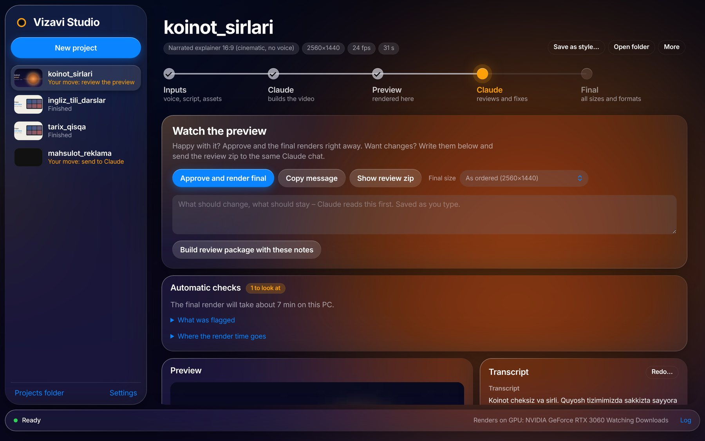
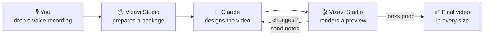
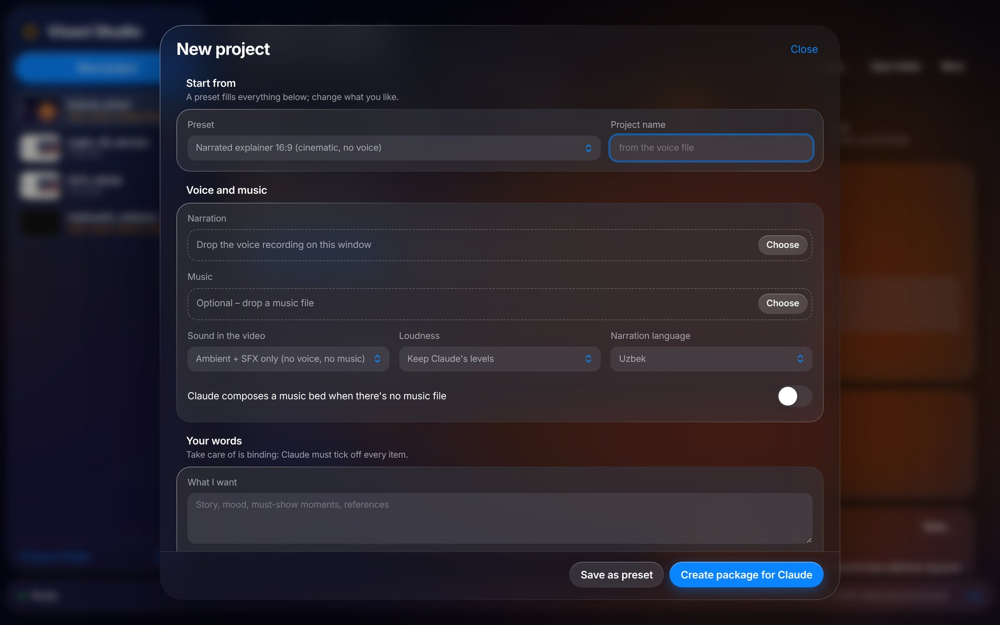

# Vizavi Studio

**Turn a voice recording into a finished video – together with Claude.**
You record your voice, Claude designs the video, your own PC renders it.

---

## What it does

Drop a voice recording on the window, say what you want, and Vizavi Studio prepares everything Claude needs
to design your video: word-by-word timing, captions, music beats, your pictures and clips. Claude sends back
the video as code, and your PC renders it – a preview first, then the final in any size you like.

- 🎙️ **Narrated explainers, Shorts, Reels, TikToks, promos, kinetic typography, logo stings** – any size and frame rate
- 🇺🇿 **Excellent Uzbek speech recognition** – exact spelling from your script, timing from your voice
- 🖥️ **Renders on your own PC** – uses an NVIDIA graphics card when you have one, the processor when you don't
- 🎞️ **Your footage stays full quality** – Claude works with small copies, the render uses your originals
- 🎨 **Save a look you like as a style** and get your next videos in the same style
- 🔄 **Updates itself** – one click when a new version is out

## How it works

You only move zip files between the app and a Claude chat – the app copies the message for you and picks up
Claude's answer from your Downloads folder by itself.

---

## What you need

| | |
|---|---|
| 💻 **Computer** | Windows 10 (1809 or newer) or Windows 11, 64-bit |
| 💾 **Disk space** | about 15 GB free |
| 🌐 **Internet** | for the first start – it downloads 2–8 GB of components, depending on your PC |
| 🤖 **Claude** | a [claude.ai](https://claude.ai) account |
| 🎮 **Graphics card** | *not required.* An NVIDIA card makes renders much faster |

## Install

> ⏱️ About 5–30 minutes, mostly waiting. You do this **once** – after that the app updates itself.

**1. Download** – click the blue **Download for Windows** button above
(or open [Releases](https://github.com/diyorvekdrs/vizavi-studio/releases/latest) and download the zip under *Assets*).

**2. Unzip** – right-click the downloaded zip → **Extract All…** → **Extract**.

**3. Install** – open the extracted folder and double-click **`Install Vizavi Studio`**.

> [!TIP]
> If Windows says **"Windows protected your PC"**, click **More info → Run anyway**.
> The app is not signed by a company, so Windows warns about it the first time.
> If it asks to install the **Microsoft Visual C++ runtime**, click **Yes**.

**4. Let it get ready** – the app opens and shows *Getting Vizavi Studio ready*. It looks at your PC and
installs only what your computer can use. Keep the window open until the bottom bar says **Ready**.
Later starts are instant.

That's it 🎉 You'll find **Vizavi Studio** on your Desktop and in the Start menu.
You can delete the downloaded zip and the extracted folder now.

> [!NOTE]
> Already have an older Vizavi Studio? Just install over it – your projects and settings stay.

---

## Make your first video

1. **Drop your voice recording** (wav, mp3, m4a…) on the window. Add music, pictures, clips or your script
   if you have them.
2. **Fill in *What I want*** – the story, the mood, must-show moments. Use *Take care of* for things
   that must or must not happen.
3. Pick a **preset** (YouTube, Shorts, Instagram…) and click **Create package for Claude**.
4. Click **Copy message**, open a **new chat** on [claude.ai](https://claude.ai), drag the zip into the chat,
   paste the message (**Ctrl + V**) and send.
5. When Claude replies with a zip, **just download it** – the app finds it and renders a preview.
6. **Watch the preview.**
   - Happy? → **Approve and render final**.
   - Want changes? → write notes, then drag the review zip into the **same** Claude chat with the copied message.
7. Your video is in the project's **output** folder (**Open folder**).

 

> [!NOTE]
> The very first transcription downloads the speech models once (a few GB), so it takes longer than the next ones.

## Updates

When a new version is out, the app shows **"Vizavi Studio X is available"** at the top.

**What's new** tells you what changed · **Update now** installs it in about a minute – the window reconnects
by itself · **Later** hides it until the next version.

Your projects, settings and installed components are never touched. If something seems wrong after an update:
**Settings → Updates → Undo last update**.

## Good to know

- 🎨 **Save as style** – liked how a video turned out? Press **Save as style…** on its page. In a new project,
  choose it under **Look → Match a saved style** and Claude makes the new video in the same look.
- ⚡ **Final size** – a 2K or 4K final takes longer. Pick a smaller *Final size* on the preview card when you
  need it fast.
- 🧾 **My rules** (Settings) – rules added to every project, e.g. *"on-screen text in Uzbek Latin only"*.
- 📁 Your videos are saved in **Videos → Vizavi Studio** (change it in Settings).

## Something went wrong?

<b>The app says a component is missing, or something didn't install</b>

Open **Settings → Check and repair components** and keep the window open until it says it's done. The log
(bottom right of the window) shows what happened. Do the same after you install a new NVIDIA driver.

<b>Double-clicking does nothing</b>

Open the app folder (`%LOCALAPPDATA%\VizaviStudio`) and run **`Start Vizavi Studio (if double-click does nothing).bat`**.
If it shows an error, send it to the person who shared the app with you.

<b>Renders are slow</b>

**Settings → This PC** shows whether the app renders on your graphics card or the processor. Without an NVIDIA
card everything runs on the processor – it works, just slower. Choosing a smaller **Final size** helps a lot.

<b>Claude's zip isn't picked up</b>

Make sure *Pick up Claude's zips from Downloads* is on in **Settings**, and that the zip went to the Downloads folder
shown there. You can always drag the zip onto the app window yourself.

<b>An update didn't work</b>

The app goes back to the previous version by itself if a new one doesn't start. You can also use
**Settings → Updates → Undo last update**. Details are in `%LOCALAPPDATA%\VizaviStudio\.update\update.log`.

## Uninstall

**Windows Settings → Apps → Vizavi Studio → Uninstall.** Your videos stay where they are.

## Privacy

Everything runs on your own PC. The app talks to Claude only through the zips **you** drag into a chat, and it
asks GitHub whether a new version exists (turn that off in **Settings → Updates**). Nothing else leaves your computer.

---

<b>For the maintainer – publishing a new version</b>

1. Change the code in `app\`.
2. Double-click **`Publish update.cmd`** and type one line about what's new.

The script raises the version, commits, tags, pushes and publishes a GitHub release with a checksum. Every
installed app offers the update within a few hours (or right away with **Settings → Check now**).
Needs [git](https://git-scm.com) and the [GitHub CLI](https://cli.github.com) (`gh auth login`).
A dry run that only lists what would be published: `py -3 app\setup\publish_update.py --dry`.

Only what `.gitignore` allows is ever published – settings, projects, models, the Python environment and your
own project library stay on your PC. More detail about features and folders: [`app/README.md`](app/README.md).

Free for personal, non-commercial use. Precise word timing uses Meta's MMS model (CC BY-NC 4.0); it can be
turned off in Settings.

