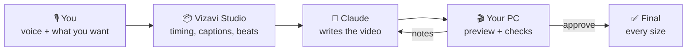

<div align="center">


# Vizavi Studio

### Turn a voice recording into a finished video – together with Claude.

You record your voice · Claude designs the video · your own PC renders it.

<br>

[](https://github.com/diyorvekdrs/vizavi-studio/releases/latest/download/Vizavi-Studio-Installer.cmd)
&nbsp;
[](https://github.com/diyorvekdrs/vizavi-studio/releases)

[](https://github.com/diyorvekdrs/vizavi-studio/releases/latest)
[](https://github.com/diyorvekdrs/vizavi-studio/actions/workflows/tests.yml)


<br>


</div>

<br>

<p align="center">
  <a href="#-what-it-does">What it does</a> ·
  <a href="#-install">Install</a> ·
  <a href="#-make-your-first-video">First video</a> ·
  <a href="#-chat-mode--no-zips">Chat mode</a> ·
  <a href="#-good-to-know">Good to know</a> ·
  <a href="#-something-went-wrong">Help</a>
</p>

---

## ✨ What it does

Drop a voice recording on the window and say what you want. Vizavi Studio prepares everything Claude needs –
word-by-word timing, captions, music beats, your pictures and clips. Claude writes the video, your PC renders a
preview, the app checks it, and after your notes you get the final in every size you need.

| | |
|---|---|
| 🎬 **Any kind of video** | Narrated explainers, Shorts / Reels / TikToks, promos, music videos, kinetic typography, logo stings – any size and frame rate |
| 🇺🇿 **Made for Uzbek** | Speech recognition tuned for Uzbek; exact spelling from your script, timing from your voice |
| 🖥️ **Renders on your PC** | Uses an NVIDIA graphics card when there is one, the processor when not – your files never leave your computer |
| 🔎 **Checks every preview** | Text cut off or under the TikTok/Reels buttons, too small, too faint, too brief, misspelled; sound and picture problems – ranked from *broken* to *polish* |
| 💬 **Chat mode** | With the Claude desktop app, Claude builds and checks the video right on your PC – no zips to move |
| ✨ **Ten signature looks** | Pick one with a moving preview – Claude gets the full recipe, frames and fonts |
| 🎨 **Your look, again** | Save a video you liked as a style and get the next ones in the same look |
| ♻️ **Fast changes** | After your notes only the seconds that changed are rendered again |
| 🔄 **Updates itself** | One click when a new version is out – with undo |

## 🧭 How it works



Two ways to talk to Claude – mix them as you like:

- **Zips** (any browser, [claude.ai](https://claude.ai)) – drag the package into a chat; the app picks up Claude's answer
  from your Downloads folder by itself.
- **Chat mode** ([Claude desktop app](https://claude.ai/download)) – Claude works on your PC directly. [How →](#-chat-mode--no-zips)

---

## 📥 Install

> **Once, about 5–30 minutes** (mostly waiting for downloads). After that the app updates itself.

| You need | |
|---|---|
| 💻 Windows 10 (1809+) or 11, 64-bit | 💾 about 15 GB free – on any drive, you choose |
| 🌐 Internet for the first start (2–8 GB of components) | 🤖 a [claude.ai](https://claude.ai) account |
| 🎮 An NVIDIA graphics card is *optional* – it makes renders much faster | |

### ⭐ Quick installer (recommended)

1. Download **[Vizavi-Studio-Installer.cmd](https://github.com/diyorvekdrs/vizavi-studio/releases/latest/download/Vizavi-Studio-Installer.cmd)** – one small file.
2. Double-click it. It downloads the newest version, verifies it and installs it.
3. It asks **where to install** – press **Enter** for drive C:, or type another drive letter (e.g. **D**) if C: is full.

> [!TIP]
> Your browser may say the file *"isn't commonly downloaded"* – choose **Keep**. When Windows says
> **"Windows protected your PC"**, click **More info → Run anyway**. The app isn't signed by a company, so Windows
> warns the first time.

<details>
<summary><b>Other ways: one PowerShell line · the classic zip</b></summary>

**PowerShell** – press **Win + X → Terminal**, paste and press **Enter** ([read the script](get.ps1) first if you like):

```powershell
irm https://raw.githubusercontent.com/diyorvekdrs/vizavi-studio/main/get.ps1 | iex
```

**Zip** – download **[Vizavi-Studio-Setup.zip](https://github.com/diyorvekdrs/vizavi-studio/releases/latest/download/Vizavi-Studio-Setup.zip)**,
right-click → **Extract All…**, then double-click **`Install Vizavi Studio`** in the extracted folder.

All three install the same thing. Installing over an older version keeps your projects and settings.
</details>

**Then let it get ready.** The app opens with *Getting Vizavi Studio ready* and installs only what your PC can use.
Keep it open until the bottom bar says **Ready** (if it asks for the *Microsoft Visual C++ runtime*, click **Yes**).
Later starts are instant – open it from the **Desktop**, the **Start menu**, or right-click a recording →
**Send to → Vizavi Studio**.

---

## 🎬 Make your first video

<p align="center"></p>

1. **New project** walks you through five short steps: your **voice** (plus music, script, pictures) →
   **what you want** → **where it will be watched** → **the look** → a final **review**.
2. Click **Create package for Claude**, then **Copy message**. Open a **new chat** on [claude.ai](https://claude.ai),
   drag the zip in, paste (**Ctrl + V**) and send.
3. When Claude replies with a zip, **just download it** – the preview renders by itself.
4. **Watch the preview.** Happy → **Approve and render final**. Changes → write notes (one per line – the quick
   buttons help), then drag the review zip into the **same** chat.
5. Your video is in the project's **output** folder (**Open folder**).

> [!NOTE]
> The first transcription downloads the speech models once (a few GB), so it takes longer than the next ones.

## 💬 Chat mode – no zips

With the [Claude desktop app](https://claude.ai/download), Claude builds the video **right on your PC**: it writes the
code, renders stills and motion strips on your graphics card, fixes what the checks find and sends each version to
Vizavi Studio – the preview appears by itself.

1. **Settings → Claude app → Connect to the Claude app**, then quit the Claude app completely and open it again (once).
2. On a new project, click **Copy message for the Claude app** and paste it into a new chat there.
3. For changes, write your notes under the preview, click **Copy message for the Claude app** again and paste it
   into the same chat.

The Claude app may ask you to allow Vizavi Studio's tools the first time. It works with every Claude account signed in
on that Windows user; zips keep working for claude.ai in the browser.

---

## 💡 Good to know

<details>
<summary><b>Show the tips</b></summary>

- ✨ **Looks** – ten ready-made looks under **Look** in a new project (Glow Orb, Frosted Glass, Apple One-Take, Retro CRT,
  Oscilloscope, Magazine, Blue Editorial, Risograph, Swiss Grid, Blueprint). Point at one to see it move; Claude gets
  its full recipe, reference frames and fonts. Adapted from [Shaan Johari's style cards](https://ruby-cotija-fb5.notion.site/Animation-styles-you-can-build-with-Claude-or-Codex-3fa28691eca3814ebb34c73a7cc261bf).
- 🎨 **Save as style** – liked a video? **Save as style…** on its page, then pick it under **Look** in a new project.
- 📐 **Size and sound** – changed your mind about the shape or the sound? **More → Size and sound…** on the project
  page. Ask for it in your notes and Claude switches it for you.
- ⚡ **Final size** – a 2K or 4K final takes longer; pick a smaller *Final size* on the preview card when you need it fast.
- 🧾 **My rules** (Settings) – rules for every project, e.g. *"on-screen text in Uzbek Latin only"*. A note you'll
  want every time? **Save as a rule…** under the notes box.
- 🎯 **Viewers should believe…** – one plain sentence the video must get across; Claude builds every scene around it.
- 🏷️ **Checks** – *Broken* and *Serious* findings are fixed first; the app asks before you approve a final that still has them.
- 🗑️ **Recently deleted** (Settings) – deleted projects and styles can be restored for 30 days; a small backup of your
  styles and project texts is made every day.
- 🗂️ Earlier finals are never overwritten – they move to *output → earlier finals*.
- 📁 Videos are saved in **Videos → Vizavi Studio** (change it in Settings).
</details>

## 🔄 Updates

When a new version is out, a bar says **"Vizavi Studio X is available"**: **What's new** · **Update now** (about a
minute, the window reconnects by itself) · **Later**. Projects, settings and components are never touched, and
**Settings → Updates → Undo last update** goes back if anything seems wrong.

## 🆘 Something went wrong?

<details>
<summary><b>A component is missing or didn't install</b></summary>

**Settings → Check and repair components**, and keep the window open until it says it's done (also after a new
NVIDIA driver). The **Log** (bottom right) shows what happened.
</details>

<details>
<summary><b>Double-clicking does nothing</b></summary>

Open the app folder (`%LOCALAPPDATA%\VizaviStudio`, or the folder you chose) and run
**`Start Vizavi Studio (if double-click does nothing).bat`**. If it shows an error, send a screenshot to whoever
shared the app with you – or [open an issue](https://github.com/diyorvekdrs/vizavi-studio/issues/new/choose).
</details>

<details>
<summary><b>Drive C: is full</b></summary>

Run the installer again and type another drive letter – it moves the program, the components and the speech models
there (nothing is downloaded twice) and offers to move your projects. **Settings → This PC** shows what is where.
</details>

<details>
<summary><b>Renders are slow</b></summary>

**Settings → This PC** shows whether renders run on the graphics card or the processor. Without an NVIDIA card it
works, just slower – a smaller **Final size** helps a lot.
</details>

<details>
<summary><b>Claude's zip isn't picked up</b></summary>

Check that *Pick up Claude's zips from Downloads* is on in **Settings** and the zip went to the folder shown there.
You can always drag the zip onto the window. A zip for a project you deleted asks you to restore it first
(**Settings → Recently deleted**).
</details>

<details>
<summary><b>An update didn't work</b></summary>

The app goes back to the previous version by itself if a new one doesn't start; **Settings → Updates → Undo last
update** does it by hand. Details: `.update\update.log` in the app folder.
</details>

<details>
<summary><b>Uninstall</b></summary>

**Windows Settings → Apps → Vizavi Studio → Uninstall.** Your videos stay where they are.
</details>

## 🔒 Privacy

Everything runs on your own PC. Claude only sees what **you** give it – the zips you drag into a chat, or the
project you open in chat mode. The app also asks GitHub whether a new version exists (turn it off in
**Settings → Updates**). Nothing else leaves your computer.

---

<div align="center">
<sub>
Free for personal, non-commercial use · Precise word timing uses Meta's MMS model (CC BY-NC 4.0, can be turned off in Settings)<br>
Working on the code? See <a href="dev/README.md">dev/README.md</a> · Found a bug? <a href="https://github.com/diyorvekdrs/vizavi-studio/issues/new/choose">Report it</a>
</sub>
</div>
